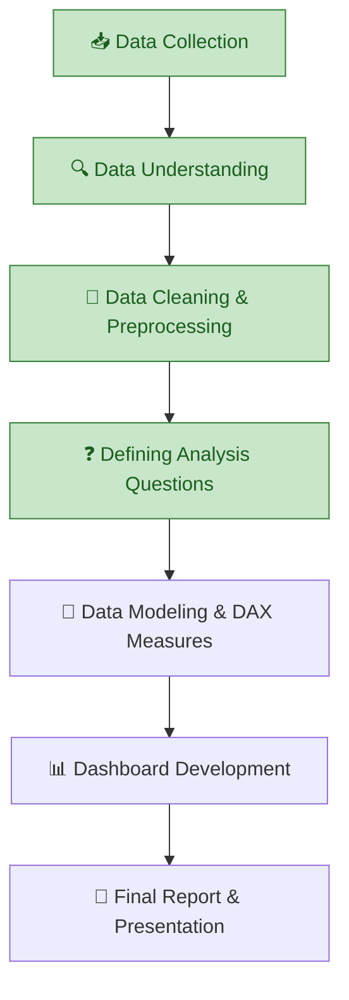

# 👥 Human Resources Dataset Analysis

### Power BI • Power Query • DAX

---

# 📌 Project Name

**Human Resources Dataset Analysis**

---

# 💡 Project Idea

This project analyzes Human Resources (HR) data using **Power BI** to uncover insights that support better workforce decisions. It is part of the **Digital Egypt Pioneers Initiative (DEPI)** data analysis track.

The project focuses on analyzing:

- Employee satisfaction levels
- Employee attrition and retention
- Workforce demographics and trends
- Factors affecting employee performance and turnover

The project also includes data cleaning and preprocessing, DAX measures, and an interactive dashboard that answers key business questions for HR decision makers.

---

# 🎯 Project Objective

- Clean and prepare employee data for analysis
- Define the key analytical questions that matter to HR decision makers
- Answer these questions through an interactive Power BI dashboard
- Provide insights and recommendations to support data-driven decisions

### Example Analysis Questions
- What is the relationship between employee age and satisfaction level?
- Which departments and job roles have the highest attrition?
- Do salary or years of experience affect satisfaction and retention?

> ✅ The analysis questions were defined after reviewing the dataset.

---

# 📂 Project Resources

| Resource | Link |
| -------- | ---- |
| Project Files (Google Drive) | [To be added] |
| Dataset Source | [Google Drive - Data Folder](https://drive.google.com/drive/folders/1iKGkAH_9yPngDTW43Y2QekH7GvbMGHwh?usp=sharing) |

---

# 🛠️ Tools & Technologies

| Tool | Purpose |
| ---- | ------- |
| Power BI | Data cleaning, analysis, and dashboard development |
| Power Query | Data cleaning and transformation (ETL) |
| DAX | KPIs and calculated measures |
| PowerPoint | Final presentation and storytelling |

---

# 🗓️ Work Plan

### Project Workflow

### Project Timeline

| Phase | Duration | Status |
| ----- | -------- | ------ |
| 🧹 Data Cleaning & Preprocessing | Week 1 | ✅ Done |
| ❓ Analysis Questions | Week 2 | ✅ Done |
| 📊 Dashboard Development | Week 3 |
